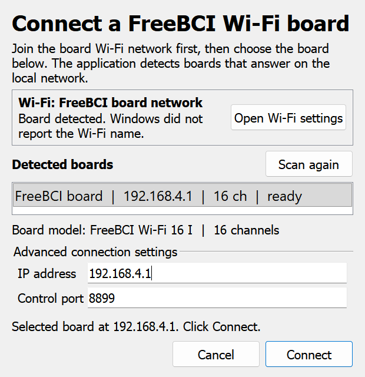

# FreeBCI GUI

FreeBCI GUI is a Windows desktop application for recording and viewing EEG and
other biosignals from FreeBCI acquisition boards. It connects over Wi-Fi, USB, or
Bluetooth, shows the signals live, and writes the raw data to disk.

## Features

- Live multi-channel traces with adjustable time window and vertical scale
- FFT and band-power views
- Brain topography on a 10-20 electrode map
- Accelerometer, external-trigger, and battery views (on supported boards)
- LSL output for use with other acquisition software
- Automatic CSV/TXT recording while streaming
- Per-channel hardware settings and electrode mapping
- Eight window layouts

## Supported boards

| Family | Models | Connection |
| --- | --- | --- |
| USB | FreeBCI-USB-8-I/II, FreeBCI-USB-16-I/II, FreeBCI-USB-24, FreeBCI-USB-32, FreeBCI-USB-64 | USB cable / USB serial port |
| Bluetooth | FreeBCI-BT-8-I/II, FreeBCI-BT-16-I/II | Bluetooth serial port |
| Wi-Fi | FreeBCI-WiFi-8-I/II/III, FreeBCI-WiFi-16-I/II/III, FreeBCI-WiFi-24, FreeBCI-WiFi-32, FreeBCI-WiFi-64 | Wi-Fi |

Accelerometer, external-trigger, and battery data are available only on boards
that provide those inputs. Unsupported views stay disabled.

## Tested hardware

The application ships with connection code for the full family, but only the
configurations below have been exercised with physical hardware. Treat the
remaining entries as implemented paths, not guarantees.

| Configuration | Transport | Status | Notes |
| --- | --- | --- | --- |
| FreeBCI-WiFi-16-I (`2037`) | USB serial | Verified | CH343 port, 16 channels, 2 Mbaud; acquisition, CSV/TXT recording, and manifest verified |
| FreeBCI-WiFi-16-I (`2038`) | Wi-Fi | Verified | Board AP, 16 channels at 250 Hz; acquisition, CSV/TXT recording, and manifest verified. The 16-channel synchronous mode is selected after the stream starts |
| FreeBCI-BT-8/16 | Bluetooth serial | Implemented, not hardware-tested | Worker and dialog are in place; requires a paired outgoing COM port |
| FreeBCI-USB high-speed | USB Serial Converter | Implemented, not hardware-tested | Uses the board's high-speed interface rather than a COM port |
| 24-, 32-, and 64-channel boards | USB serial / Wi-Fi | Implemented, not hardware-tested | Channel counts and layouts are supported by the same core |

If a transport fails, first confirm the board model in the **Boards** menu, then
try the USB serial path. The Terminal log records the exact connection error.

## Requirements

- Windows 10 or 11, 64-bit
- Python 3.9, 64-bit
- About 700 MB of free disk space for the Python environment
- The FreeBCI board, its power supply, and electrodes
- An internet connection while installing

The BrainFlow build that talks to FreeBCI hardware is included in the
`brainflow/` folder. Do not install a separate BrainFlow package; the copy in
this repository is the tested version for these boards. Its `nptyping`
dependency is installed with the other Python packages.

The USB serial driver recommended by the board manufacturer is required for USB
connections. Bluetooth boards must be paired in Windows before you connect.

## Installation

### Option 1: automatic setup

1. Install [uv](https://docs.astral.sh/uv/):
   ```bat
   winget install --id=astral-sh.uv -e
   ```
2. In Explorer, double-click **`setup_env.cmd`**.

   The script creates a `.venv` folder, downloads Python 3.9 and the required
   packages, and finishes the environment setup. This can take several minutes.

3. Double-click **`run.cmd`** to start the application.

### Option 2: manual setup

Open Command Prompt in this folder and run:

```bat
py -3.9 -m venv .venv
.venv\Scripts\python.exe -m pip install --upgrade pip
.venv\Scripts\python.exe -m pip install -r requirements.txt
.venv\Scripts\python.exe setup_env.py
```

If `py -3.9` is not available, install Python 3.9 (64-bit) from
[python.org](https://www.python.org/downloads/) first.

Then start the GUI:

```bat
run.cmd
```

or:

```bat
.venv\Scripts\python.exe FreeBCI_GUI.py
```

Keep the application files together. The program loads its images, settings,
and bundled BrainFlow library from the repository folder, so moving only the
program files will not work.

## Quick start

1. Connect the board and power it on.
2. Start `run.cmd`.
3. Open **Boards**, choose your board model, then choose the connection type.
4. Fill in the connection dialog and click **Connect**.
5. Click **Start Session**.
6. Click **Stop Session** when you are finished. The recording is saved
   automatically.

## Try without hardware

Choose **File > Start Demo Session** (or press **Ctrl+Shift+D**) to run the
interface against a synthetic 16-channel, 250 Hz board. The demo exercises the
same acquisition, plotting, LSL, recording, and diagnostics paths as a real
session, so it is a safe way to check an installation or follow the screenshots
without a board. Demo recordings are written under the normal data folder.

## Benchmark the pipeline

`tools/benchmark_session.py` runs the same acquisition and recording path
against the synthetic board and prints sample throughput, block count, queue
depth, lost samples, and the recording location.

```
.venv\Scripts\python.exe tools\benchmark_session.py --seconds 10
```

Use `--channels`, `--rate`, `--output`, and `--json` to change the workload or
capture machine-readable results. The benchmark is a pipeline smoke test, not a
substitute for a hardware performance test.

## Automated tests

Run the test suite from the repository root:

```
.venv\Scripts\python.exe -m unittest discover -s tests -v
```

The tests cover recording and manifests, acquisition faults, the control API,
LSL fan-out, Wi-Fi discovery, packet-loss accounting, and repeated session
lifecycles. They use the synthetic board and do not require FreeBCI hardware.
A Windows GitHub Actions workflow runs the same suite.

## Soak test

`tools/soak_session.py` runs one longer synthetic session and reports throughput,
lost samples, display drops, queue depth, and process memory:

```
.venv\Scripts\python.exe tools/soak_session.py --minutes 10
```

Use it before a release to check that memory and queues stay flat. It drains the
display queue like the GUI, so display drops should stay at zero; a growing
writer queue or lost-sample count indicates a real bottleneck.

## Build a release

`tools/build_release.py` creates a source release zip that includes the
application, the bundled BrainFlow build, settings, documentation, and setup
scripts. It is not a Python wheel.

```
.venv\Scripts\python.exe tools\build_release.py --version 0.1.0
```

The archive is written to `dist\FreeBCI_GUI-0.1.0.zip`, with a SHA-256 sidecar
next to it. Unpack the zip on the target computer and run `setup_env.cmd` once,
then `run.cmd`. The build script refuses to create an archive if a required
file or directory is missing.

## Connecting a board

Open the **Boards** menu and select the exact model printed on the board. Each
model submenu offers the connection methods that model supports.

### Wi-Fi

1. Connect the computer to the board's Wi-Fi network. The network name starts
   with `FreeBCI-`.
2. Choose the board model and **WiFi** in the **Boards** menu.
3. The dialog scans the local network automatically. It shows the current Wi-Fi
   status and any boards that answered, with their address and channel count.
4. Select the detected board and click **Connect**. If the board is on a
   different address, edit the IP address and port under **Advanced connection
   settings**, then click **Connect**.



The dialog chooses the board type from the model you selected in the **Boards**
menu; the BrainFlow board ID is not shown. Detection probes the board's HTTP
service, so it reports an actual reachable board rather than assuming that a
configured ID is online. VPN software and restrictive firewalls can block
detection.

For a 16-channel Wi-Fi board, the application selects 16-channel synchronous
sampling automatically when the session starts. No manual channel-mode command
is required.

### USB serial port

1. Connect the board with a USB cable and install its serial driver if Windows
   does not show a new COM port.
2. Choose **USB Serial Port** in the board submenu.
3. Select the COM port and click **Connect**.

If several ports are listed, unplug the board to see which entry disappears.

For the tested FreeBCI-WiFi-16-I in USB mode, the path is
**Boards > FreeBCI-WiFi-16-I > USB Serial Port**, then select the CH343 port
(usually `COM3`). The application switches the board to 16-channel, 2 Mbaud
operation automatically.

### Bluetooth

1. Pair the board in **Settings > Bluetooth & devices**.
2. In Windows Bluetooth settings, note the **Outgoing** COM port for the board.
3. Choose **Bluetooth Serial Port** in the board submenu.
4. Select the port, keep the baud rate at `921600`, and click **Connect**.
   **Scan** refreshes the list of available ports.

### USB high-speed connection

Some USB boards use a high-speed interface instead of a virtual COM port. Choose
**USB Serial Converter** in the board submenu and click **Connect**.

### After connecting

The dialog reports `connection successfully!` and the main window status changes
to `Session started!`. Click **Start Session** to begin acquisition. If the
connection fails, check the cable, the port, and the board's power, then close the
dialog and try again.

## Main window

The top bar contains:

- **Start Session / Stop Session** - start or stop acquisition and recording.
- **Notch Filter** - None, 50 Hz, or 60 Hz.
- **BP Filter** - None, 5-50 Hz, 7-13 Hz, 15-50 Hz, 1-50 Hz, or 1-100 Hz.
- **Terminal** - open the live console log.
- **Layout** - choose one of eight window arrangements.

The status line below the toolbar shows frames per second, packet loss, and the
number of samples received. Packet loss should stay close to zero. A steadily
rising value usually means a weak Wi-Fi or Bluetooth link.

The notch and band-pass filters affect the plots, FFT, band power, and
topography. They do not change the recorded files, which always contain the raw
samples.

To disconnect, open **Boards > Disconnect**. This also stops the session.

## Views

Each panel has a small dropdown in its header. Use it to change which view is
shown in that panel.

### Time Series

Shows each channel as a scrolling trace.

- **Time Window** - default 5 seconds, or 1, 3, 5, or 10 seconds.
- **Vert Scale** - automatic scaling, or a fixed range from 50 uV to 10000 uV.
- Channel buttons turn an individual trace on or off.
- The round button next to a channel starts an impedance check for that channel.
  A good contact gives a low, stable value.
- **Hardware settings** opens the board configuration dialog. Stop the session
  first.

### FFT Plot

Shows the frequency spectrum of the last few seconds of data.

- **Max Freq** - 20 to 800 Hz.
- **Max uV** - vertical range.
- **Log / Linear** - frequency-axis scale.
- Channel buttons choose which channels are included.

### Band Power

Shows the power in the standard EEG bands for each channel. Use it to compare
activity between regions or over time.

### Brain topography

Draws the selected channels on a 10-20 electrode map. The **Channels-electrodes
settings** button opens the electrode mapping dialog.

## Electrode mapping

The topography view needs to know which electrode each channel is connected to.

1. Stop the session.
2. Open **Brain topography > Channels-electrodes settings**.
3. For each channel, select the electrode position. Leave unused channels as
   **Unused (leave blank)**.
4. Click **Apply** to update the map.
5. Use **Save** and **Load** to keep the mapping as an XML file.

The repository includes example mappings in the `settings` folder.

## Hardware settings

Stop the session before opening **Hardware settings**. The dialog can change:

- **Sample Rate** - 250, 500, 1000, 2000, 4000, 8000, or 16000 Hz, depending on
  the board.
- **Baud Rate** - serial connection speed.
- **Data Mode** - what the auxiliary channels carry: accelerometer, external
  trigger, or battery, depending on the board.
- **Send Mode** - board protocol.
- **PCA Gains** - input gain (X1 to X24).
- **Input Type** - normal, shorted, bias measurement, and other test modes.
- **Bias Include**, **SRB1**, **SRB2** - reference and bias configuration.

**Send** applies the settings to the board in the background; the dialog remains
responsive and reports progress or the failing command. **Save** and **Load**
store them as an XML file. Leave advanced settings at their defaults unless you
know the required configuration for your electrodes.

Changes take effect when you start the session again. Stop the session first,
apply the change, then click **Start Session**.

## LSL output

The **Networking** view can publish up to three Lab Streaming Layer (LSL)
streams, so other software can record or process the incoming signal at the
same time.

1. Open the **Networking** view.
2. For each stream you want, set the stream name, for example `FreeBCI_EEG1`.
3. Set **Data Type** to **Time Series**. Leave a row at **None** to disable it.
4. Set the stream **Type** (the default `EEG` is suitable for EEG data).
5. Click **Start LSL Stream**. Click **Stop** to end all streams.

Each enabled row publishes the same current signal under its own stream name.
Each stream also gets the stable source id `FreeBCI:<stream name>`, which lets
consumers identify the same source across sessions. Samples are staged in a
bounded queue (4096 samples per stream) and sent as chunks; if the GUI cannot
keep up, the oldest staged samples are dropped and the count is shown in
**Session Diagnostics** rather than blocking acquisition.

Starting LSL also creates a `FreeBCI_Markers` stream (type `Markers`, one string
channel, irregular rate). Manual markers and control-API markers are pushed to
that stream when it is active, so an LSL recorder can align events with the
signal. The markers are still written to `markers.jsonl` and the manifest even
when no LSL marker stream is running.

The streams appear in LSL-aware applications such as LabRecorder, OpenViBE, or
MNE.

## Recording

Recording starts automatically when you click **Start Session**. There is no
separate record button.

By default, files are written under `logs` next to the application:

```text
logs\
  Console_Data\
    Console_2026_11_01_143000.txt
  Recordings\
    Stream_2026_11_01_143005\
      1.csv
      1.txt
      1.meta.json
      manifest.json
      markers.jsonl
      session.log
      .writing
      2.csv
      2.txt
      2.meta.json
      ...
```

Each session gets its own `Stream_<date>_<time>` folder. Files roll over
automatically: `1.csv` and `1.txt` hold the first 90,000 samples, `2.*` the next
90,000, and so on. Every data file has a matching `.meta.json` sidecar with its
sample count, checksum, and timing information. `manifest.json` describes the
whole session and is finalized when the session stops. It is also written at
session start and refreshed every few seconds, so an interrupted session leaves
a manifest with `status: recording` instead of no metadata. It records
`lost_samples` and a `gaps` list if the board skipped samples.

`session.log` is a JSON-lines diagnostic log for the recording writer (start,
close, markers, gaps, queue failures, write errors). `.writing` exists only
while the writer is active; the application removes it on a clean stop. If the
application or machine stops unexpectedly, the next launch reports how many
unfinished sessions were found and leaves their files untouched for inspection.

`manifest.json` follows the `freebci.session/1` schema: it includes the app
version, device and sample-rate configuration, host start/stop timing, a chunk
list with checksums, the sample count, and a stop reason alongside the legacy
`files`/`samples_recorded` fields. Firmware and serial-number fields are not
populated because the current transport layer does not expose them.

### Markers

Press **Ctrl+M** or choose **File > Add Marker** while a session is active to
record a manual marker. Each marker stores the session-relative sample offset,
elapsed time, and wall-clock time. Markers are appended immediately to
`markers.jsonl` and also included in `manifest.json`, so they survive an
interrupted session. External software can add labeled markers through the
control API described below.

The sample offset is the number of samples received when the marker was
requested. It is not a hardware trigger timestamp.

### Session diagnostics

Press **Ctrl+D** or choose **File > Session Diagnostics...** to open a live
status window. It shows the session state, effective sample rate, sample and
block counts, lost samples, display drops, time since the last block, marker
count, writer queue depth, last write duration, manifest status, recorded file
count, output folder, control endpoint, and active LSL streams. A growing
"Since last block" value warns that the board has stopped delivering data. **Copy summary** puts the same information on the
clipboard for a bug report.

### CSV files

The first row names the channels, followed by the three auxiliary inputs:

```csv
channel1,channel2,...,channel32,<AUX 0>,<AUX 1>,<AUX 2>
12.345678,...
```

EEG values are in microvolts. Auxiliary values depend on the selected data mode
(accelerometer, trigger, or battery).

### TXT files

The matching `.txt` file is a whitespace-friendly copy with a short header:

```text
FreeBCI Raw Data
Number of Channels: 32
Sampling Rate: 250 Hz
Board: FreeBCI-USB-32
1 2 3 ... <AUX 0><AUX 1><AUX 2>
Start Time:2026_11_01_143005
```

### Changing the data folder

Set the `FREEBCI_HOME` environment variable before starting the application:

```bat
set FREEBCI_HOME=D:\FreeBCI_data
run.cmd
```

The `Console_Data` and `Recordings` folders are created inside that directory.
To make the change permanent, add `FREEBCI_HOME` in Windows **Environment
Variables**.

**File > Open** opens the recordings folder. The **Terminal** button opens the
live console log.

## Control API

The application starts one small control endpoint on `127.0.0.1` for its whole
lifetime. It is only reachable from the same computer and requires the random
token printed in the Terminal log at startup:

```text
FreeBCI: control API tcp://127.0.0.1:54321 token ... (discovery ...\control.json)
```

The same endpoint is written to `control.json` in the FreeBCI data folder. It
stays there while the application is open, including while idle, and is removed
on exit. Treat it as a secret because it contains the token.

Use it from another Python process to read status, start a session for a selected
board, add a marker, stop the recording, or close the application:

```python
from freebci.core import ControlClient

client = ControlClient.from_discovery(r"logs\control.json")
# from_runtime_file(path) is an equivalent alias.
print(client.status())          # {"state": "idle", ...} before a session
client.start("demo")            # synthetic demo session
client.wait_started()           # poll until armed/recording, or time out
# client.start("2038")          # already-connected FreeBCI Wi-Fi 16 board
# client.start("FreeBCI_WiFi_16_I")
client.marker("stimulus on")
client.stop()
# client.shutdown()             # close the GUI as well
```

`start(selector)` requires a board selector: a board id such as `"2038"`, the
catalog name, or `"demo"`. A real-board selector must match the board currently
connected in the GUI; an idle app cannot auto-detect a board from this command.
It returns `"start_requested"` and is rejected if a session is already active or
starting. Poll `status()` until it reports `recording`. `stop()` asks the GUI to
stop and returns `"stop_requested"`; the session finalizes on the next GUI event.
`shutdown()` asks the GUI to close, which also stops the session and releases the
board; a control shutdown skips the manual close confirmation so it cannot block
an automated caller. `marker()` records a labeled event at the current sample offset and returns
the marker record; it requires an active session.

Requests carry a client-generated `id` and the response echoes it. A failed
request returns an `error` plus a stable `code`, such as `no_session` when no
recording is active or `busy` when a session is already running or starting.
`ControlClient` raises `ControlError` with the same `code` attribute.

`clock_offset()` performs several `time` exchanges and returns the best
server-minus-client offset in nanoseconds, an `uncertainty_ns` equal to half the
minimum round trip, the `round_trip_ns`, and the number of samples. This is a
host-clock estimate for local coordination, not a hardware synchronization claim.

`status()` returns the session state, sample and block counts, elapsed time,
lost samples, markers, the latest block's host timestamps, and the server
`clock_id` with its current `monotonic_ns` and `wall_ns`.

## Troubleshooting

### `uv` is not found

Install uv with `winget install --id=astral-sh.uv -e`, reopen Command Prompt, and
run `setup_env.cmd` again. Alternatively, follow the manual setup steps above.

### The application does not start

Run `run.cmd` from Command Prompt so the error message stays visible. Common
causes are a missing `.venv`, a 32-bit Python installation, or an interrupted
package install. Re-run `setup_env.cmd` (after removing `.venv`) or reinstall the
requirements.

### `pyqtgraph` reports a Qt binding error

Run `.venv\Scripts\python.exe setup_env.py` again, then start with `run.cmd`. If
you launch Python directly from another shell, set `PYQTGRAPH_QT_LIB=PyQt5`
first.

### No COM port is listed

Install the USB serial driver for the board, use a data-capable USB cable, and
check Windows **Device Manager** for a port marked with a warning. Close other
programs that may be using the port.

### Wi-Fi connection fails

Join the board's own Wi-Fi network first. Disable VPN software temporarily, allow
the application through Windows Firewall, and click **Scan again**. If the board
is still not listed, open **Advanced connection settings** and enter its IP
address and port directly. The board is normally at `192.168.4.1`, port `8899`.

### The board connects but the traces are flat

Click **Start Session**. Check that the channel is enabled, the electrode is
attached, and the correct reference and bias settings are selected. Use the
impedance button in the Time Series view to check contact quality.

If the status bar shows `Waiting for data from the board...`, the connection is
up but no samples are arriving. Check the board's own web page or indicator,
power-cycle the board, and try the USB serial connection. The Terminal log shows
whether the transport is timing out.

### Recordings are missing

Recording only runs while a session is active. Check `logs\Recordings`, or the
folder named by `FREEBCI_HOME` if you set it. The current log in
`logs\Console_Data` records connection and save errors.

### Packet loss is high

Move the computer closer to the board, reduce the sample rate in **Hardware
settings**, or use a USB connection instead of Wi-Fi or Bluetooth.

## Project layout

```text
FreeBCI_GUI.py            application entry point
brainflow/                bundled BrainFlow build for FreeBCI hardware
freebci/                  application package
  app.py                  Qt composition root and window bootstrap
  api/                    acquisition, recording, and view logic
  core/                   session, acquisition, and recording services
  design/                 window and dialog layouts
settings/                 example hardware and electrode XML files
tests/                    automated tests, including the synthetic board
tools/                    developer utilities (benchmark, soak, release build)
electrodes_pos_32.png     head model for 32-channel topography
electrodes_pos_64.png     head model for 64-channel topography
requirements.txt          Python dependencies
setup_env.cmd             one-step environment setup (uv)
setup_env.py              environment finishing step
run.cmd                   start the application
logs/                     created at first run
```

`brainflow/` is bundled and intentionally not installed from PyPI. The source
release zip is the supported distribution; no wheel/`pyproject.toml` package is
planned.

The target architecture in `ARCHITECTURE_REVIEW.md` Sections D–I is a design
proposal, not a file inventory. Current implementation status and the
section-by-section gaps are recorded in that document's phase tracker and
Section M.
